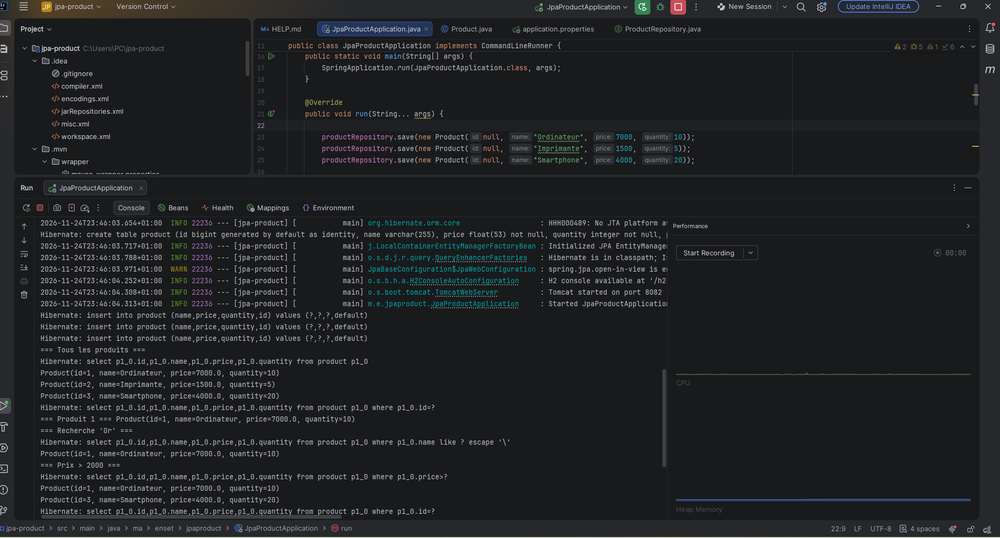
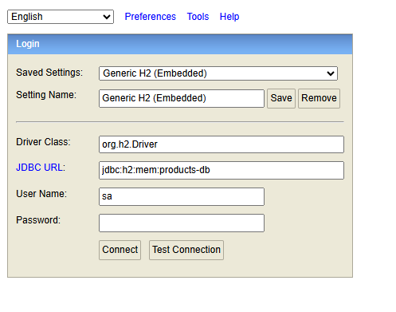
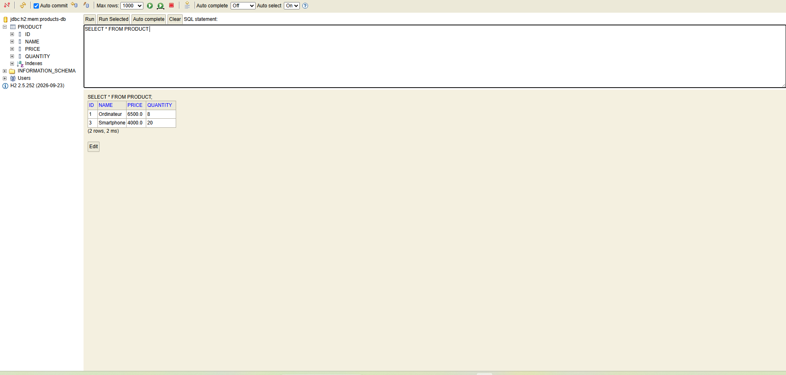

# Activité Pratique N°2 : ORM JPA, Hibernate, Spring Data

**Réalisé par :** Yasmine Ghissassi, Génie informatique, Mundiapolis
**Support :** vidéo "First Demo" de Mohamed Youssfi (https://www.youtube.com/watch?v=UXs39oVoaSs)

---

## 1. Introduction

Cette activité consiste à construire une application Spring Boot qui gère des produits dans une base H2 en mémoire, sans écrire de SQL à la main, grâce au mapping objet-relationnel (ORM) fourni par JPA, Hibernate et Spring Data JPA. Elle couvre la création de l'entité `Product`, la configuration de la persistance, la création d'un repository et le test des opérations d'ajout, de consultation, de recherche, de mise à jour et de suppression.

## 2. Rappel théorique

L'ORM associe une classe Java à une table, un attribut à une colonne et une instance à une ligne, ce qui évite de convertir les données à la main. **JDBC** est l'API de bas niveau de Java pour dialoguer avec une base. **JPA** est la spécification standard de l'ORM (annotations et `EntityManager`), **Hibernate** en est l'implémentation qui génère réellement le SQL, et **Spring Data JPA** génère automatiquement les repositories à partir d'une simple interface.

## 3. Outils et technologies

| Outil | Rôle |
|---|---|
| Java 21 (Temurin) | Langage et machine virtuelle |
| Spring Boot, Spring Initializr | Socle de l'application et génération du projet |
| Spring Data JPA, Hibernate | Repositories, mapping objet-relationnel, génération du SQL |
| H2 Database | Base de données relationnelle en mémoire |
| Spring Web | Serveur web embarqué, nécessaire à la console H2 |
| Lombok | Génération du code répétitif par annotations |
| Maven, IntelliJ IDEA | Gestion du projet et environnement de développement |
| Git, GitHub | Versionnement et hébergement |

## 4. Création du projet

Projet généré avec Spring Initializr : Maven, Java 21, Jar, Group `ma.enset`, Artifact `jpa-product`, avec les dépendances **Spring Web**, **Spring Data JPA**, **H2 Database** et **Lombok**.

## 5. Architecture

```
jpa-product
├── src/main
│   ├── java/ma/enset/jpaproduct
│   │   ├── entities/Product.java
│   │   ├── repository/ProductRepository.java
│   │   └── JpaProductApplication.java
│   └── resources/application.properties
├── screenshots
├── pom.xml
└── README.md
```

## 6. Entité Product

```java
@Entity
@Data @NoArgsConstructor @AllArgsConstructor @Builder
public class Product {
    @Id @GeneratedValue(strategy = GenerationType.IDENTITY)
    private Long id;
    private String name;
    private double price;
    private int quantity;
}
```

`@Entity` déclare la classe comme persistante, `@Id` désigne la clé primaire et `@GeneratedValue(IDENTITY)` laisse la base générer l'identifiant, d'où le `null` passé à la création. Lombok fournit les getters, setters, `toString` (`@Data`), les deux constructeurs et le patron Builder. Les colonnes `price` et `quantity` sont non nulles car leurs types Java sont primitifs.

## 7. Configuration (application.properties)

```properties
spring.application.name=jpa-product
server.port=8082
spring.datasource.url=jdbc:h2:mem:products-db
spring.h2.console.enabled=true
spring.jpa.show-sql=true
spring.jpa.hibernate.ddl-auto=update
```

L'URL `jdbc:h2:mem:products-db` crée une base **en mémoire** : les données disparaissent à l'arrêt. `show-sql` affiche le SQL généré, `ddl-auto=update` crée ou ajuste la table à partir de l'entité, et la console H2 est activée sur le port 8082.

## 8. Repository

```java
public interface ProductRepository extends JpaRepository<Product, Long> {
    List<Product> findByNameContains(String keyword);
    List<Product> findByPriceGreaterThan(double price);
}
```

`JpaRepository<Product, Long>` fournit `save`, `findAll`, `findById` et `deleteById` sans implémentation. Les méthodes `findByNameContains` et `findByPriceGreaterThan` sont dérivées de leur nom : Spring Data en génère les requêtes `LIKE` et `>`.

## 9. Tests des opérations

Les tests s'exécutent au démarrage grâce à `CommandLineRunner`.

```java
@SpringBootApplication
public class JpaProductApplication implements CommandLineRunner {

    @Autowired
    private ProductRepository productRepository;

    public static void main(String[] args) {
        SpringApplication.run(JpaProductApplication.class, args);
    }

    @Override
    public void run(String... args) {
        // 1. Ajouter
        productRepository.save(new Product(null, "Ordinateur", 7000, 10));
        productRepository.save(new Product(null, "Imprimante", 1500, 5));
        productRepository.save(new Product(null, "Smartphone", 4000, 20));

        // 2. Consulter tous
        productRepository.findAll().forEach(System.out::println);

        // 3. Consulter un produit
        Product p = productRepository.findById(1L).orElse(null);
        System.out.println(p);

        // 4. Chercher
        productRepository.findByNameContains("Or").forEach(System.out::println);
        productRepository.findByPriceGreaterThan(2000).forEach(System.out::println);

        // 5. Mettre à jour
        if (p != null) {
            p.setPrice(6500);
            p.setQuantity(8);
            productRepository.save(p);
        }

        // 6. Supprimer
        productRepository.deleteById(2L);
        productRepository.findAll().forEach(System.out::println);
    }
}
```

Chaque opération affiche son résultat dans la console au lancement de l'application :

- **Ajout** : trois produits sont insérés (Ordinateur, Imprimante, Smartphone). `save` avec un `id` nul provoque un `insert`.
- **Consultation de tous les produits** : `findAll()` retourne la liste complète.
- **Consultation d'un produit** : `findById(1L)` retourne un `Optional`, ce qui oblige à gérer l'absence de résultat.
- **Recherche** : `findByNameContains("Or")` retourne l'Ordinateur, `findByPriceGreaterThan(2000)` retourne l'Ordinateur et le Smartphone.
- **Mise à jour** : `save` sur un objet qui possède déjà un `id` provoque un `update`.
- **Suppression** : `deleteById(2L)` retire l'Imprimante.



## 10. Console H2

La console H2 est accessible sur `http://localhost:8082/h2-console` pendant l'exécution de l'application. Sur la page d'accueil, il faut renseigner l'URL JDBC `jdbc:h2:mem:products-db`, l'utilisateur `sa` et un mot de passe vide, puis cliquer sur **Connect**.



La requête `SELECT * FROM PRODUCT` affiche ensuite l'état final de la base, sans l'imprimante supprimée et avec l'ordinateur mis à jour.



## 11. Difficultés rencontrées

| Difficulté | Solution |
|---|---|
| Option Spring Initializr absente d'IntelliJ | Elle existe seulement dans Ultimate ; en Community, générer le projet sur start.spring.io |
| Annotations Lombok en rouge | Attendre la fin du téléchargement Maven et recharger le projet |
| Imprimante absente de la console H2 | Normal : le code la supprime à la dernière étape |

## 12. Conclusion

Cette activité a montré la réduction de code permise par JPA, Hibernate et Spring Data : une classe annotée définit une table, et une interface vide hérite de toutes les opérations de gestion des données. Les méthodes dérivées expriment une recherche par le simple nom d'une méthode, et Lombok allège les entités. Pour aller plus loin, il reste à exposer ces opérations dans un contrôleur REST documenté avec OpenAPI, puis à remplacer H2 par MySQL ou PostgreSQL pour obtenir une vraie persistance.

## 13. Exécuter le projet

```bash
git clone https://github.com/juanito-y/jpa-hibernate-spring-data.git
cd jpa-hibernate-spring-data
./mvnw spring-boot:run
```

Sous Windows : `mvnw.cmd spring-boot:run`.
